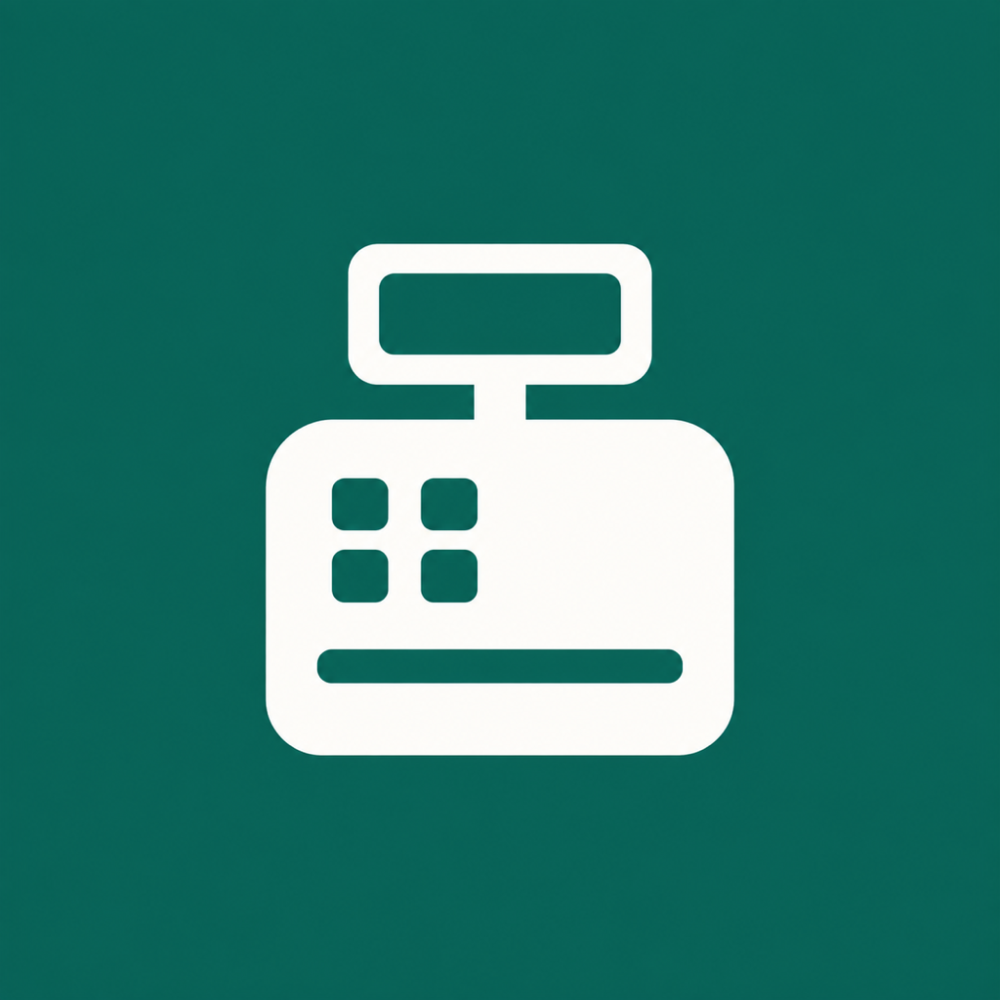

# かんたんレジ

SwiftUI製のシンプルな対面レジ。iPhone・iPad・iPhone Duoで共通の操作を使えます。
iOS / iPadOS 17以降。オフラインで動作し、広告・ログイン・外部ライブラリはありません。



## 起動

1. `KantanRegister.xcodeproj` をXcodeで開きます。
2. スキーム `KantanRegister` とiPhoneまたはiPadシミュレータを選び、⌘Rで起動します。
3. iPhone Duoの検証には、Duo対応のXcodeとシミュレータランタイムが必要です。Device Hubで端末を選択します。

シミュレータ実行にApple Developer登録は不要です。実機ではSigning & Capabilitiesで自分のTeamを選択してください。

## 操作

- **設定／商品名・価格**：商品を追加・編集。削除は商品行を左にスワイプします。
- **レジ／会計を開始**：商品ボタンで追加。＋・−で数量変更、商品取消・全て取消で取り消します。
- **お客様側**：一覧と合計を180度回転して表示。お客様から見て下詰めにし、オペレータ側との間に余白を置きます。一覧をタップして商品を選び直せます。
- **釣り銭計算**：計算のみ行います。
- **会計確定**：預かり額を確認し、画面下部の「会計を確定して記録」で売上を保存します。
- **日報／売上集計**：日付を選び、売上を確認・CSVを書き出します。

白・チャコール・深緑の配色と角丸ボタンを共通化しています。画面幅に応じて文字・余白・ホームの列数を調整し、狭い画面の商品一覧はスクロールできます。

## キリ銭の自動入力

合計を1,000円単位で切り上げます。10,644円なら11,000円を自動入力し、釣り銭356円を表示します。
テンキーの最初の入力で自動入力額を置き換えます。20,000円なら釣り銭9,356円です。
「消去」で全桁を消し、「計算し直す」で自動入力額に戻します。預かり額が不足する場合は確定できません。

## 保存・CSV

商品設定と確定した会計はアプリ内の `Application Support/KantanRegister/data.json` に保存します。
商品名・価格を変更しても過去の会計の名前・価格は変わりません。会計途中の商品はアプリの再起動でリセットされます。

CSVは選択日の確定会計の明細をUTF-8 BOM付きで出力します。
列は「会計ID、日時、商品名、単価、数量、小計、会計合計」。一商品につき一行です。
会計合計は各商品行に繰り返されるため、売上集計には小計列を合算します。日付・時刻は端末のタイムゾーンです。

## テスト

Xcodeで⌘U、または次のコマンドを実行します。端末名はインストール済みのシミュレータに置き換えてください。

```sh
xcodebuild test -project KantanRegister.xcodeproj -scheme KantanRegister \
  -destination 'platform=iOS Simulator,name=iPhone 18 Pro' \
  CODE_SIGNING_ALLOWED=NO
```

単体テスト5件で数量・取消・釣り銭・保存と再読込・保存失敗・CSVを確認します。
UIテスト3件で会計から日報までのフロー、初回と再表示の確定ボタン、回転後のカート保持と操作ボタンを確認します。
UIテストはメモリ内のデータを使い、通常操作の設定・売上を変更しません。

2026-10-05、Xcode 27.1 beta（27A9269）で次の各8件、計24件が成功しました。

| 端末 | ランタイム | 結果 |
| --- | --- | --- |
| iPhone 18 Pro | iOS 27.0 | 8件成功 |
| iPad Pro 13-inch (M5) | iOS 27.0 | 8件成功 |
| iPhone Duo | iOS 27.1（24A94401） | 8件成功 |

Duoの開閉・折り曲げ全姿勢、Split View、実機での動作は自動テストの範囲外です。

## アイコン

1024pxのオリジナルアイコンをAsset Catalogに収録しています。
原本は `Design/AppIcon.png` です。原本をアプリアイコンとホーム画面のロゴに反映するには、`python3 Design/generate_icon.py` を実行します。アプリのビルドにはPythonは不要です。

2026-10-05、正式版 Xcode 27.0（27A266a）・iPhone 18 Pro Max / iOS 27.0 で単体テスト5件とUIテスト3件が成功しました。回転時のUIテストはレイアウトの更新を最大5秒待って操作可能性を確認します。
